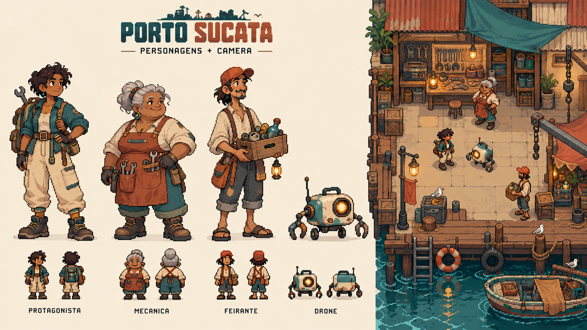
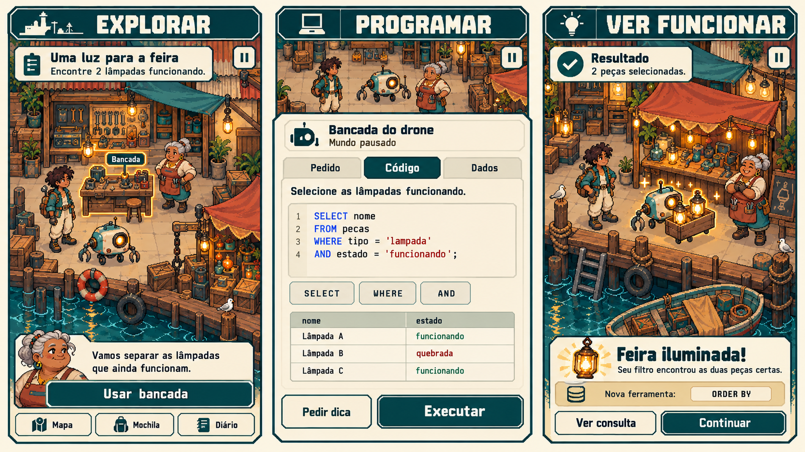
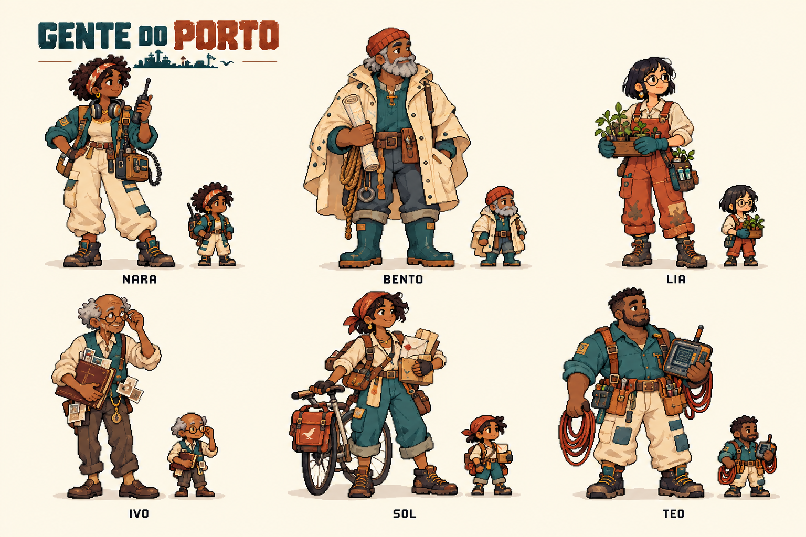
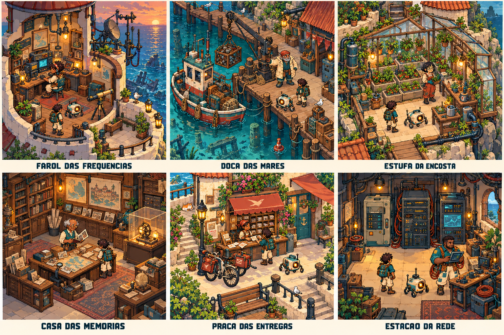

# Porto Sucata

Uma aventura single player em pixel art 2D, pensada para celular: explorar um porto, conhecer seus moradores e usar código para recuperar máquinas, resolver mistérios e transformar os lugares.

**Estado atual: primeira missão jogável — Uma luz para a feira.** Explore o cais, inspecione peças, consulte o catálogo com SQL real e veja o drone iluminar a barraca.

## Executar localmente

Requer Node.js 22.12+ ou 24 e npm.

```sh
npm ci
npm run dev
```

`npm run build` gera a versão estática em `dist`. `npm run preview` abre esse build localmente.

```sh
npm test
npm run test:e2e
```

Os testes de navegador usam Microsoft Edge instalado (`channel: msedge`). Ajuste o canal no Playwright para outro Chromium instalado se necessário. As capturas de revisão são geradas em `.impeccable/review/`.

## O que está funcionando

- Pátio com personagem independente, movimento por toque/setas e conversas.
- Catálogo com quatro peças inspecionáveis, editor e dicas graduais.
- SQLite real no navegador, isolado em worker; consultas equivalentes aceitas por resultado.
- Seleção visual, feedback de erros e entrega pausável do drone.
- Barraca iluminada, diário, manual e salvamento local do progresso/rascunho.

Esta versão tem uma missão. Os outros cenários continuam conceituais. Os sprites ainda usam uma pose por personagem; não há animação direcional, áudio, conta, sincronização nem modo offline garantido. O dialeto executado é SQLite, não uma implementação completa de MySQL/Oracle.

## Comece aqui

- [CONTEXTO_DO_PROJETO.md](CONTEXTO_DO_PROJETO.md): memória principal e detalhada do projeto; ler antes de modificar qualquer coisa.
- [AGENTS.md](AGENTS.md): instruções de continuidade para agentes e colaboradores.
- [Referências visuais e procedência](art/references/README.md): pranchas aprovadas, limites de uso e inventário.

## Identidade visual









As imagens são conceitos de direção de arte, não sprites prontos ou capturas de uma implementação. Preservar personagens, atmosfera e hierarquia; adaptar densidade, enquadramento e legibilidade ao celular.

## Princípios

- Mundo acolhedor, paleta pouco saturada e progresso visível.
- Explorar → programar → observar → corrigir → transformar o porto.
- Código e resultados verificáveis; simulações identificadas.
- Sessões curtas, pausáveis e retomáveis, sem punição por ausência.
- Pixel art no mundo; texto e código legíveis nos painéis.

Toda alteração deve atualizar `CONTEXTO_DO_PROJETO.md` no mesmo conjunto de mudanças. O contexto distingue recursos implementados, propostas e decisões pendentes.
